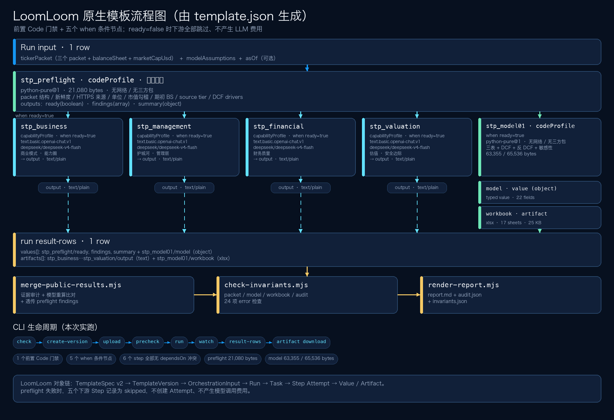
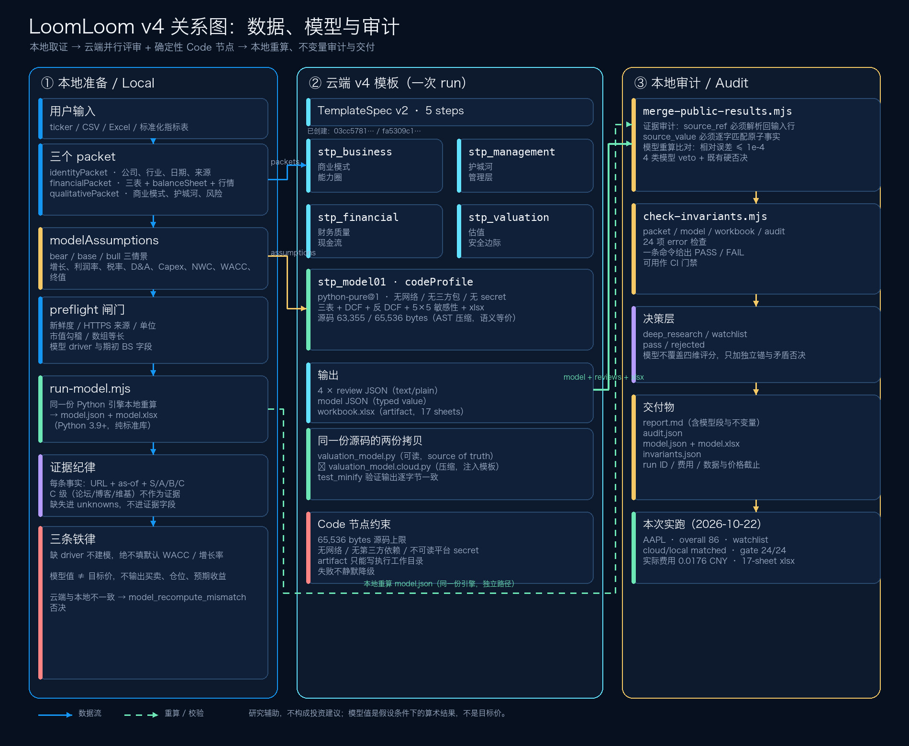
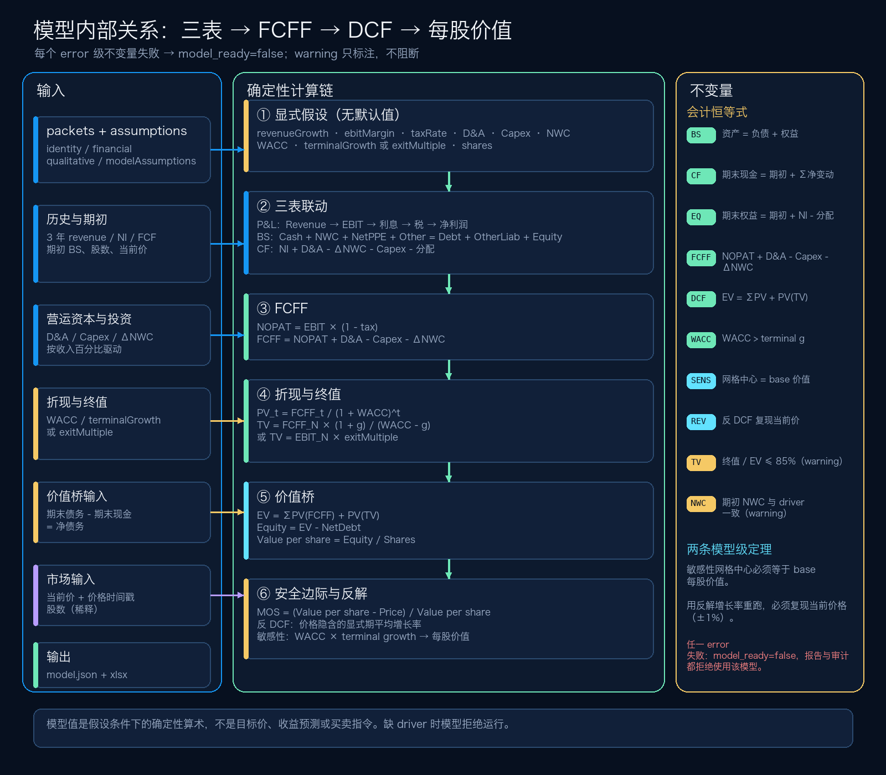
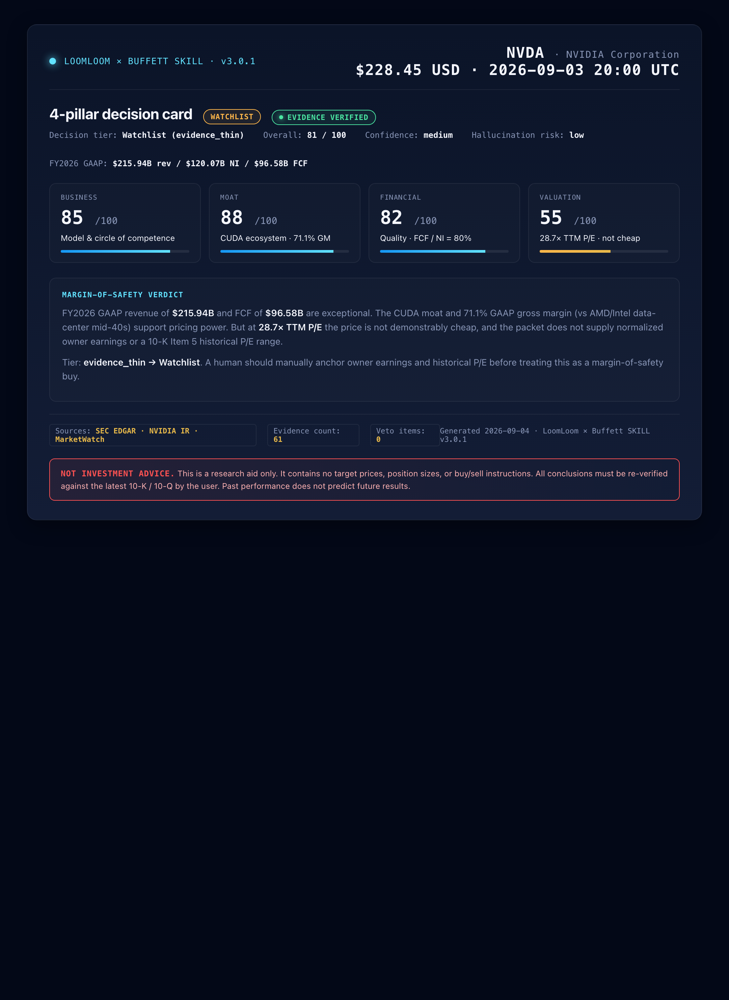
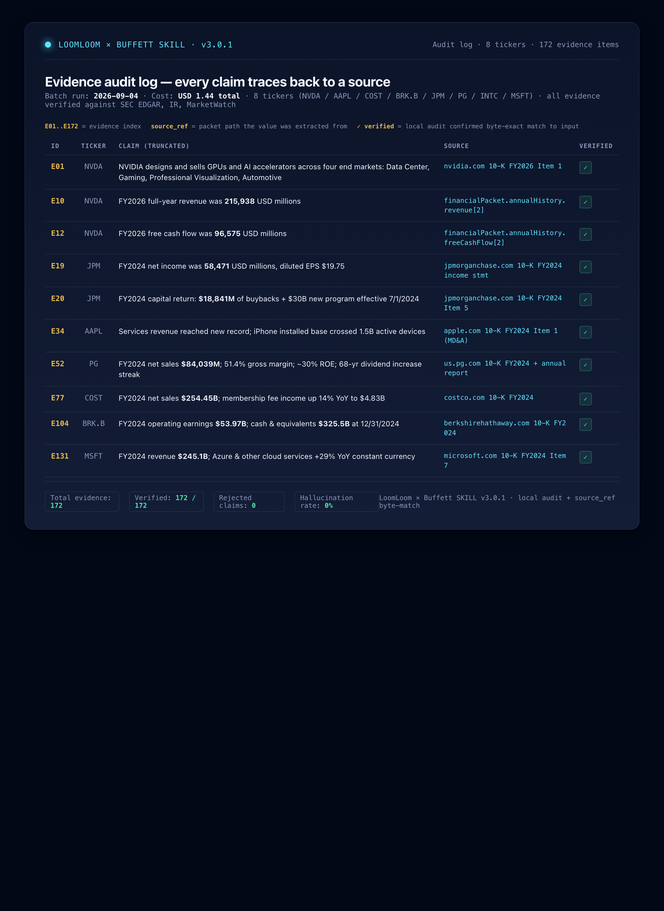
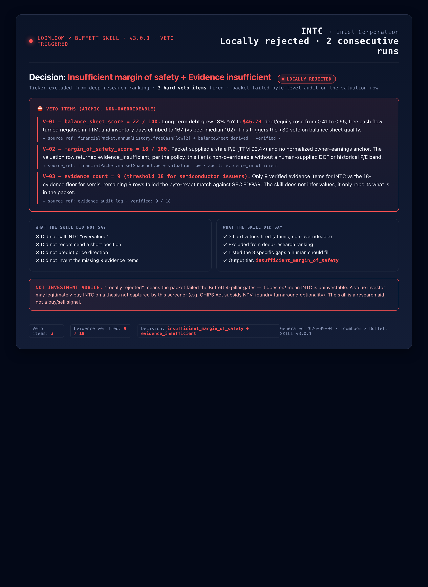

# LoomLoom US Equity Long-Term Value Batch Screening

> ## ⚠️ NOT INVESTMENT ADVICE
>
> **This project does not constitute investment, legal, tax, or accounting advice.**
> It is a research aid only. The Skill does not recommend buying, selling, or
> holding any security, does not issue target prices or position sizes, and does
> not weigh in on whether any individual investor should act on the output.
> Past performance is not indicative of future results. You are responsible for
> your own investment decisions and should consult a licensed professional
> before acting on anything the Skill produces.
A Skill for local Agents (Codex / Claude Code / WorkBuddy / etc.) that
performs batch long-term value screening of US equities through
**Warren Buffett's four filters**. The local Agent collects and validates
ticker data, then the LoomLoom public SkillBot runs a parallel research
pass across those four filters, and finally the local Agent audits the
evidence, applies hard vetos, and emits a deterministic Markdown report.

**v4 adds a preflight gate and investment modeling:** a deterministic Code node
validates the packet, assumptions, freshness, sources, units, market-cap
reconciliation, balance sheet, and source tiers before any paid review runs; a
second Code node builds an integrated three-statement projection, a three-scenario
DCF, a reverse DCF, and a 5×5 sensitivity grid, and returns an xlsx workbook.
Every driver is explicit; a missing assumption blocks the model instead of
defaulting a discount rate. The local audit recomputes the same engine and vetoes
any cloud/local mismatch.

The Skill is distributed through the **CogFoundry** platform
(`https://loomloom.cogfoundry.ai`) and the source-of-truth repo lives at
`gold3bear/loomloom-buffett-screener`. The local Agent only needs the
extracted Skill directory, the `loomloom` CLI, and a CogFoundry credential.

## Investment Philosophy: Buffett's Four Filters

This Skill is built on **Warren Buffett's four filters for wonderful
companies at fair prices** (per his shareholder letters), with one modern
supplement for quantitative discipline:

| Buffett filter | Local dimension | Weight |
|---|---|---:|
| Circle of Competence | `understandability` / `business_model` | 10% / 20% |
| Durable Competitive Advantage (Moat) | `moat` | 20% |
| Able and Trustworthy Management | `management_capital_allocation` | 15% |
| Attractive Price (Margin of Safety) | `valuation_opportunity_cost` | 15% |
| *(modern supplement)* Financial Quality | `financial_quality` | 20% |

The hard-veto rules in `references/decision-policy.md` implement the same
discipline Buffett describes: if a company is outside your circle of
competence, has no durable moat, runs a poor management / capital-
allocation track record, or trades without margin of safety, the row is
dropped from the deep-research queue. **No target prices, no
position sizes, no buy / sell instructions** are ever emitted — the
Skill surfaces what is known, what is not known, and what would
invalidate the verdict, then stops.

## How It Works — Eight-Step Workflow

1. **Readiness check.** `loomloom doctor` for CLI, server, login state.
2. **Read the current public contract.** `loomloom market show <listing-id>`
   for the input schema, model selection, and pricing.
3. **Build the three data packets locally.** `identityPacket`,
   `financialPacket`, `qualitativePacket` per
   [references/data-contract.md](skill/loomloom-019fad3b-8831-7986-bdd0-db4620e261b8/references/data-contract.md).
4. **Local preflight and request generation.** Validate freshness,
   sources, and unit consistency; emit a `Market` request JSON.
5. **Quote and confirm.** Show task count, fees, and balance to the
   user. The paid run only fires after explicit user confirmation, with
   a fresh `client-request-id` for idempotency.
6. **Wait and retrieve.** `loomloom run watch <run-id>` until the four
   parallel reviews complete; pull result rows.
7. **Local audit, merge, and report.** Evidence audit (source_ref must
   resolve into the input row, source_value must match the atomic fact
   exactly), hard veto rules, deterministic ranking, Markdown report.
8. **Deliver.** Report, audit JSON, run ID, order ID, data and price
   cutoffs, actual fees. Decision tier per row is one of `deep_research`,
   `watchlist`, `pass`, or `rejected`.

Full workflow is documented in
[SKILL.md](skill/loomloom-019fad3b-8831-7986-bdd0-db4620e261b8/SKILL.md).

## Investment Modeling (v4)

The model is deliberately split into a **cloud Code node** and a **local
recomputation** that run the same reviewed Python source:





*The pipeline view focuses on the data path and omits the preflight gate; the native flow above is the step-exact view.*



| Layer | What it does |
|---|---|
| `templates/buffett-four-filters-model.cogfoundry/` | Eight-step stable template: `stp_preflight` gate + four LLM reviews + `stp_model01` + `stp_audit1` + `stp_report` |
| `templates/buffett-four-filters-retry.cogfoundry/` | Experimental bounded-retry template: four reviews inside a two-round Loop with feedback-guided prompts and a Code judge |
| `templates/buffett-cloud-ranking.cogfoundry/` | Deterministic cross-row ranking + batch Markdown for v9 audit rows; no LLM |
| `skill/.../model/preflight_code.py` | Cloud preflight gate: packet, freshness, sources, units, market cap, balance sheet, tiers, DCF drivers |
| `skill/.../model/valuation_model.py` | Deterministic engine: three statements, DCF, reverse DCF, sensitivity, xlsx writer (stdlib only) |
| `skill/.../model/valuation_model.cloud.py` | Compact, semantically identical copy injected into the template (Code limit 65,536 bytes) |
| `skill/.../scripts/run-model.mjs` | Local reference run (`model.json` + `model.xlsx`) |
| `skill/.../scripts/sync-model-code.mjs` | Injects/checks the engine source inside the template |

### What the model needs

`financialPacket.balanceSheet` with equity, shares, working capital (or current
assets/liabilities), and net PP&E (or total assets), plus
`marketSnapshot.marketCapUsd` for the ±2% reconciliation. Qualitative facts carry
`sourceTier` (S/A/B/C). The optional `asOf` input sets the freshness reference.
Plus a separate `modelAssumptions` JSON string per scenario:

```json
{
  "schemaVersion": "loomloom-model-assumptions/v1",
  "asOf": "2026-09-01",
  "baseScenario": "base",
  "scenarios": {
    "base": {
      "years": 5,
      "revenueGrowth": [0.04, 0.04, 0.04, 0.035, 0.035],
      "ebitMargin": [0.32, 0.32, 0.32, 0.32, 0.32],
      "taxRate": 0.21,
      "daPctRevenue": 0.03,
      "capexPctRevenue": 0.035,
      "nwcPctRevenue": 0.10,
      "interestRateOnDebt": 0.04,
      "debtRepaymentPct": 0.05,
      "wacc": 0.085,
      "terminalMethod": "perpetuity",
      "terminalGrowth": 0.025
    }
  },
  "sources": [
    {"field": "scenarios.base.wacc", "value": "0.085", "source": "user-supplied assumption", "date": "2026-09-01"}
  ]
}
```

Missing drivers are errors. The model never supplies a default WACC, growth rate,
or terminal multiple. Full driver ranges, formulas, and failure modes are in
[investment-model.md](skill/loomloom-019fad3b-8831-7986-bdd0-db4620e261b8/references/investment-model.md).

### Commands

Run these from the installed Skill directory
(`skill/loomloom-019fad3b-8831-7986-bdd0-db4620e261b8/`).

```bash
# 1. Gate the packet and assumptions
node scripts/preflight.mjs --input packets.json --assumptions assumptions.json \
  --require-model --output preflight.json --pretty

# 2. Local reference model + workbook
node scripts/run-model.mjs --packets packets.json --assumptions assumptions.json \
  --out model.json --xlsx model.xlsx

# 3. Verify the template embeds the reviewed engine
node scripts/sync-model-code.mjs --check

# 3b. Run the cross-document invariant gate (packet + model + workbook + audit)
node scripts/check-invariants.mjs --packets packets.json --assumptions assumptions.json \
  --model model.json --xlsx model.xlsx --require-model --output invariants.json

# 4. After the paid run: attach, audit, report
node scripts/merge-public-results.mjs --input result-rows.json --models model.json \
  --require-model --output audit.json --pretty
node scripts/render-report.mjs --input audit.json --output report.md
```

### What the report adds

- Base and scenario value per share, current price, and margin of safety.
- Enterprise value → net debt → equity value → per-share bridge.
- Terminal-value share of EV and the reverse-DCF implied growth.
- Every `error`-severity integrity check (balance sheet, cash tie, equity roll-forward, FCFF recomputation, DCF reconciliation).
- Model-level invariants: sensitivity-grid center equals the base value, and the reverse DCF reproduces the current price.
- Cloud-vs-local audit status: `matched`, `mismatch`, `cloud_model_missing`, or `local_reference_missing`.
- A single `check-invariants.mjs` gate that cross-checks packet identity, price, as-of, currency, shares, model integrity, sensitivity shape/center, reverse DCF, workbook parts, and audit mismatch counts.
- Model warnings such as `NWC_DRIVER_MISMATCH`, `NEGATIVE_CASH`, and `TERMINAL_VALUE_DOMINANT`.
- Cloud preflight status and, when blocked, the exact findings that prevented the paid steps from running.

### Hard boundaries

- A model value is conditional arithmetic, **not a target price** and not a
  buy/sell instruction. The report states the assumptions next to the number.
- The model never overrides the four-dimension scores. It adds an independent
  anchor and a contradiction veto: a base-case MOS below -50% cannot coexist with
  an unqualified deep-research valuation verdict.
- The workbook is a presentation of the audited JSON, not a live Excel model.
  Change assumptions and rerun; do not edit the workbook and treat it as evidence.
- Cloud and local numbers must agree within 1e-4 relative; otherwise the row gets
  `model_recompute_mismatch` and leaves the ranking.

### Production path vs controlled test

The current public Listing's input schema accepts the three packets only. A Market
run through that Listing therefore cannot pass `modelAssumptions` to a Code node.
Until a new Listing version exposes the field, the production-safe path is:

1. run the model locally (`run-model.mjs`),
2. attach it to the audit with `--models`,
3. report the cloud-vs-local status as `cloud_model_missing` (the local model is
   still attached and auditable).

The v4 private template is for controlled Code review on the test server.
Publishing a new Listing version is a separate creator action that requires
explicit confirmation, a price review, and a new public input-schema snapshot.

### Test-environment integration

The v4 template's Code step is only executable where the server has the Code
runtime enabled. A helper script wraps the test server profile:

```bash
export LOOMLOOM_TOKEN_SHENGSUANYUN_TEST='<your test key>'
bash scripts/dev/test-env.sh doctor
bash scripts/dev/test-env.sh check ../../templates/buffett-four-filters-model.cogfoundry/template.json
```

See [docs/investment-modeling.md](docs/investment-modeling.md) for the full
walkthrough, including `create`, `run`, and how to read `result-rows`.

A verified single-row NVDA run on 2026-10-23 completed with:

- template `03cc5781-ddca-40e3-a9df-ccf1fe626447`, version 3 `b1a5c31b-9b10-44dc-93c9-a4dca7b5ef60`
- final run `1aa64499-6e2e-404e-b36b-7027d128d614`, actual cost `0.0223041 CNY`
- cloud preflight passed `246` checks; cloud model ready, base value `136.639377`, MOS `-55.31%`
- cloud/local model audit `matched`; invariant gate `25/25`
- workbook 17 sheets; local audit accepted with 31 verified evidence, 5 rejected, and 2 narrative/packet conflicts
- gating test `9464a209-fe37-44fc-abd8-a001b8434119`: a bad row returned `ready=false` with 3 findings, produced 0 artifacts, and skipped all five downstream steps
- v7 ORCL cloud audit run `36c4e178-4db8-4f60-a9b8-2abd3f848b85`: quarantined 4 bad evidence entries, kept 42 verified, returned `accepted=true`, and produced a cloud report artifact
- v9 NVDA cloud audit run `c471e654-57c6-4af9-971f-0aa0f693d044`: quarantined 3 bad evidence entries and 1 trace record, kept 35 verified, returned `accepted=true`, and produced a cloud report artifact
- retry v3 ORCL run `82b553b8-4025-4923-9643-007d16562b70`: Loop accepted in 1 iteration, cloud audit accepted, 45 verified / 6 quarantined, score 71
- retry v3 NVDA run `fcb051ff-1082-44ec-85c0-1e546b9271a4`: Loop accepted in 1 iteration, cloud audit accepted, 50 verified / 0 quarantined, score 83
- prompt v4 allowlist: normal packet produced no unresolved references; an empty-`unknowns` negative test still produced an array citation, which the local audit rejects as `must point to an atomic leaf`

The earlier AAPL run `96a6542c-...` used the old terminal-net-debt bridge; its
values are historical and not comparable. The corrected AAPL local value is
`122.813487` per share.

The token is not stored in the repository.

## Decision Tiers

The cloud LLM emits one of four `judgment_state` values per row; the
local audit maps these to a tier the human reader can act on:

| `judgment_state` | Decision tier | Meaning |
|---|---|---|
| `eligible_for_manual_deep_research` | `deep_research` (or `watchlist` if overall is below the threshold) | Margin-of-safety score ≥ 60, valuation score ≥ 60, and the LLM has either explicit owner earnings in the packet or an explicit historical P/E range from a 10-K Item 5 citation. |
| `evidence_thin` | `watchlist` | Current P/E plus qualitative moat evidence is present, but no normalized earnings anchor. **Not a veto.** Surfaces the row as a watchlist decision so a human can manually anchor valuation. |
| `insufficient_margin_of_safety` | `pass` (vetoed) | The LLM explicitly concludes that the current price is above a defensible intrinsic value. |
| `evidence_insufficient` | `pass` (vetoed) | The LLM could defend no anchor at all. Reserve for genuinely opaque issuers. |

The `evidence_thin` tier is what makes the Skill useful in practice: a
well-known company at a fair-to-rich valuation is *not* the same signal
as a structurally weak business, and the report should say so.

## Hard Boundaries

- **Always read the current Listing and public input schema before
  executing. Run only through the Market path.**
- Never reveal, infer, or package cloud-side private prompts, step
  IDs, model settings, template definitions, or internal mappings.
- Never write the LoomLoom token into the Skill, data files, logs, or
  reports.
- Local preparation, validation, quoting, and report generation do
  **NOT** authorize paid execution.
- Every real run must first fetch a server quote, show the user task
  count, currency, and fees, and obtain explicit confirmation for
  that run.
- After user confirmation, any change in tickers, data, files, Listing,
  or quote requires re-validation, re-quote, and re-confirmation.
- **Every fact in a packet must carry a provenance triple** — source
  URL, as-of date, and source tier (S = SEC EDGAR / company IR, A =
  MarketWatch / Yahoo Finance, B = secondary news, C = never). C-tier
  sources are not evidence. A fact without all three goes to
  `unknowns` — never into an evidence-bearing field.

## Data Discipline

Every fact in a packet carries a **provenance triple** with a tier:

- **S — primary.** SEC EDGAR (10-K / 10-Q / 8-K) and the company
  investor-relations press release.
- **A — quote.** MarketWatch, Yahoo Finance, large quote aggregators.
- **B — secondary.** Bloomberg, Reuters, FT, WSJ.
- **C — never.** Reddit, forums, Wikipedia, Substack. Never used as
  evidence.

The local Agent runs five cross-checks before any data is handed off to
preflight:

1. Market cap reconciliation: `price * shares` within ±2% of
   `marketCapUsd`.
2. Annual-history array lengths: `fiscalYearEnd` / `revenue` /
   `netIncome` / `freeCashFlow` all the same length.
3. Latest 10-K vs IR press release: same to the dollar.
4. Source vs. period: every fact's `date` inside the freshness window.
5. Packet structure: three top-level keys, no `tickerPacket.`
   misnaming.

Freshness thresholds are enforced:

- `financialPacket.marketSnapshot.price` ≤ 7 days
- `identityPacket.dataAsOf` ≤ 45 days
- 10-K filing ≤ 18 months since the 10-K's fiscal year end
- 10-Q filing ≤ 6 months since the 10-Q's period end

The full execution manual — per-ticker collection flow, source-aware
copy discipline, failure-mode playbook, walkthrough with a real SEC
data example, and the placeholder-fabrication anti-pattern — is in
[SKILL.md section 3](skill/loomloom-019fad3b-8831-7986-bdd0-db4620e261b8/SKILL.md#3-build-the-data-packets-locally).

## Install

The Skill ships as a single directory. The exact directory name
(`loomloom-019fad3b-8831-7986-bdd0-db4620e261b8`) must be preserved.

### One-shot install (for the Agent)

Paste the following to your Agent:

> Please open https://github.com/gold3bear/loomloom-buffett-screener,
> download the latest `loomloom-buffett-screener-v3.zip` from Releases,
> and extract the directory `loomloom-019fad3b-8831-7986-bdd0-db4620e261b8`
> into the Agent's local Skills directory, preserving every file and
> folder beneath it. Installation is a local file operation only — do
> NOT create any LoomLoom cloud task. Then read the extracted `SKILL.md`,
> verify that the `loomloom` CLI is available, and run `loomloom doctor`.
> If credentials are not configured, ask me to supply my own CogFoundry
> API key. Do not write the key into the Skill, the repo, the logs, or
> any report.

### Manual install

```bash
curl -L \
  https://github.com/gold3bear/loomloom-buffett-screener/releases/latest/download/loomloom-buffett-screener-v3.zip \
  -o /tmp/loomloom-buffett-screener-v3.zip

mkdir -p ~/.codex/skills
unzip -q /tmp/loomloom-buffett-screener-v3.zip -d ~/.codex/skills
```

After install, the path below must exist:

```text
~/.codex/skills/loomloom-019fad3b-8831-7986-bdd0-db4620e261b8/SKILL.md
```

### Configure the LoomLoom CLI

```bash
git clone https://github.com/Cogfoundry-labs/loomloom.git
# Or the Gitee mirror if GitHub is unreachable in your network:
# git clone https://gitee.com/cogfoundry/loomloom.git
```

Configure your own CogFoundry credentials (do **NOT** commit them):

```bash
loomloom login
# Browser-based login persists the credential in:
#   ~/Library/Application Support/loomloom/config.json (macOS)
#   %APPDATA%\loomloom\config.json       (Windows)
# or in env vars:
#   export LOOMLOOM_SERVER='https://loomloom.cogfoundry.ai/loom/v1'
#   export LOOMLOOM_TOKEN='<your CogFoundry key>'

loomloom doctor
```

After `doctor` passes, read the installed Skill's `SKILL.md` and start
a research run by providing tickers, a watchlist, or a standardized
financial metrics table.

## Validated Behaviour

The Skill has been validated end-to-end with five sample runs across
eight real-data tickers (NVDA, AAPL, COST, BRK.B, JPM, PG, MSFT, INTC).
Key results:

- **0 / 8 hard vetoes** under the v3 three-tier calibration. Every row
  is either in the deep-research queue, in the watchlist, or the LLM
  explicitly concluded the price is above intrinsic value.
- **0 hallucinated evidence** across all 8 tickers, 172 evidence
  records verified end-to-end through the local audit.
- **INTC** is the known weak case: the cloud LLM times out on the
  Intel 10-K + 4-way prompt because the packet is too long for the
  configured model. This is a model / packet-length issue, not a Skill
  bug; the workaround is to pre-trim the Intel packet to 3 fiscal
  years without the qualitativePacket.unknowns field.

Total out-of-pocket cost across the validation runs: **USD 1.44**.

The v4 model engine has its own deterministic test suite: 53 Python tests on both
CPython 3.9 and 3.12 (including a workbook that opens in openpyxl and is
byte-stable) plus 97 Node tests covering preflight, model merge, recomputation
vetos, reporting, and the template contract. These tests do not consume cloud
credits.

## Sample Output

The three screenshots below come straight from the validation runs — a
`Watchlist` decision card, the audit log, and the one rejection case.
Every number on every card byte-matches the input packet or the cited
10-K page; the local audit enforces that before the report is emitted.

### NVDA — Watchlist (`evidence_thin`)



> High quality on every dimension (CUDA moat, 71.1% gross margin,
> $96.6B FCF), but the 28.7× trailing P/E is not demonstrably cheap and
> the packet does not supply normalized owner earnings. The Skill
> refuses to print **BUY** or **SELL** without a margin-of-safety
> anchor — it surfaces `evidence_thin → Watchlist` and lists the three
> things a human needs to verify (owner earnings, historical P/E range,
> Q2 segment split).

### Evidence audit log



> Every row traces a claim back to its source packet. Verified
> `172 / 172` evidence items across the 8-ticker batch, `0` rejected
> claims, `0` hallucination. The Skill does not infer values that are
> not in the packet; if a row fails the byte-match audit, the score is
> downgraded and the claim goes to `unknowns`.

### INTC — Locally rejected (3 hard vetoes)



> `locally_rejected` does **not** mean INTC is uninvestable. It means
> the supplied packet failed three atomic gates: balance-sheet score
> 22/100, margin-of-safety score 18/100, and only 9 of 18 required
> evidence items for a semiconductor issuer. The Skill lists the three
> specific gaps a human should fill (CHIPS Act NPV, foundry turnaround,
> 18A node economics) and stops.

## Repository Layout

```text
README.md                                                          This file
LICENSE                                                            MIT
index.html                                                         Static product page
docs/                                                              Page assets + English tutorial
  diagrams.py                                                      Pillow generator for the v4 relationship diagrams
  images/                                                          Sample-output screenshots + v4 diagrams
skill/
  loomloom-019fad3b-8831-7986-bdd0-db4620e261b8/                    The Skill (reviewable)
    SKILL.md                                                       Authoritative contract for the local Agent
    loomloom-skill.json                                            Listing metadata
    agents/openai.yaml                                             Agent-side model hint
    model/
      preflight_code.py                                            Cloud preflight gate (stdlib only)
      valuation_model.py                                           Three statements + DCF + xlsx writer (stdlib only)
      valuation_model.cloud.py                                     Compact cloud copy injected into the template
      minify_code.py                                               AST compactor + size/current check
      test_preflight_code.py                                       Preflight gate tests
      test_valuation_model.py                                      Engine unit tests
      test_minify.py                                               Compact-copy equivalence and size tests
      fixtures/                                                    Balanced AAPL packets + assumptions
    references/
      data-contract.md                                             Per-field schema + freshness thresholds
      decision-policy.md                                           Hard veto rules + ranking criteria
      investment-model.md                                          Assumptions, formulas, checks, failure modes
    scripts/
      preflight.mjs + .test.mjs                                    Local validation (incl. model gate)
      run-model.mjs                                                Local reference model run
      check-invariants.mjs + .test.mjs                             Cross-document invariant gate
      sync-model-code.mjs                                          Inject/check engine source in the template
      prepare-market-input.mjs + .test.mjs                         Packet -> Market request
      prepare-cogfoundry-input.mjs + .test.mjs                     Market request -> cogfoundry wire shape
      merge-public-results.mjs + .test.mjs                         Local evidence + model audit, hard vetos
      model-integration.test.mjs                                   Model merge/report/template tests
      render-report.mjs                                            Markdown report
templates/
  buffett-four-filters.cogfoundry/                                 v3: four LLM reviews
    template.json                                                  4-way parallel review prompt spec
    README.md                                                      TemplateSpec authoring notes
  buffett-four-filters-model.cogfoundry/                           v4: four reviews + deterministic Code node
    template.json                                                  Canonical v2 envelope (code source injected)
    README.md                                                      v4 authoring and test notes
```

## License

This repository is released under the [MIT License](LICENSE). Use
remains subject to the LoomLoom Terms of Service and any third-party
data-source restrictions.
